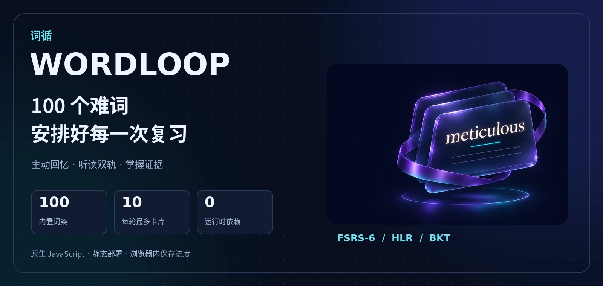
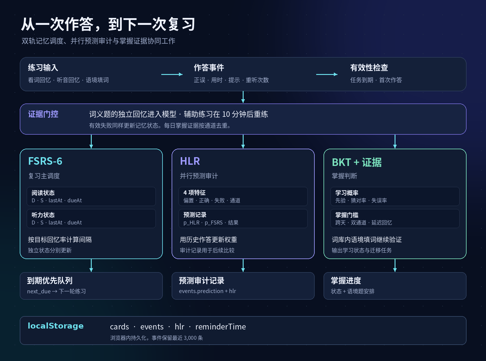
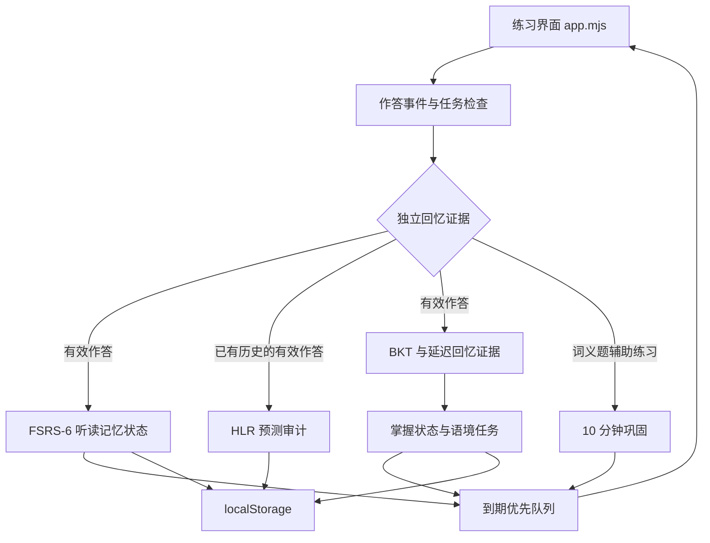

<p align="center">
  
</p>

<h1 align="center">WORDLOOP · 词循</h1>

<p align="center"><strong>先回忆，再核对，到点复习。</strong></p>
<p align="center">A lightweight vocabulary trainer with spaced review, listening practice, and evidence-based progress tracking.</p>

<p align="center">
  
  
  
  
</p>

<p align="center">
  <a href="https://wordloop-100.d65zq.chatgpt.site/">在线体验</a> ·
  <a href="#quick-start">本地启动</a> ·
  <a href="#product-tour">页面导览</a> ·
  <a href="#architecture">系统架构</a> ·
  <a href="#contributing">参与贡献</a>
</p>

词循帮助学习者记牢 100 个较难识记的英语单词。每轮最多 10 张卡片，到期内容优先。用户先写出词义，再核对释义、例句和记忆场景，系统根据作答质量安排下一次练习。

应用使用原生 JavaScript、CSS 和 HTML。100 个词条、100 段合成发音与 200 道语境填词题随仓库提供，学习状态保存在当前浏览器。含音频和配图的静态文件不到 1 MiB。

<a name="quick-start"></a>
## 本地启动

准备 Git、Python 3 和支持 ES Modules 的现代浏览器，在终端运行以下命令。

```bash
git clone https://github.com/xqxq-2020/WORDLOOP.git
cd WORDLOOP
python3 -m http.server 8000 --bind 127.0.0.1 --directory dist
```

打开 [http://localhost:8000](http://localhost:8000)，点击 **开始练习**。Windows 环境也可以使用 `py -m http.server 8000 --bind 127.0.0.1 --directory dist`。

静态托管时，将 `dist/` 的内容设为站点根目录。入口是 `index.html`，浏览器会加载相对路径下的模块、词库、样式和音频。

## 值得关注的实现

| 能力 | 用户能感受到的变化 | 对应实现 |
| --- | --- | --- |
| 3D 界面 | 深色玻璃卡片有空间光影，首页配图随指针轻微倾斜 | CSS 透视和原生指针事件，支持系统的减少动态效果设置 |
| 主动回忆 | 先输入一个中文词义，再看到参考释义 | 释义别名匹配、正误反馈、记忆场景 |
| 听读双轨 | 看见认识、听到想不起来的词可以分别练习 | 每词分别维护阅读和听力的难度、稳定性与到期时间 |
| 到期优先 | 打开应用就有一轮明确的练习任务 | FSRS-6 调度、到期排序、每轮同词去重、新词日限额 |
| 作答证据门控 | 提示后的巩固和独立回忆各有记录 | 提示次数、曝光间隔、重听次数、任务有效性检查 |
| 可解释的掌握进度 | 经过跨天验证，再进入已掌握和会运用 | BKT 概率、双通道延迟回忆、词库内语境填词 |
| 预测审计 | 后续可以用真实作答评估预测误差 | 保存作答前的 FSRS、HLR 预测和作答结果 |
| 日历提醒 | 把下一次复习或每日练习放进日程 | 导出带提醒的 `.ics` 日历文件 |

<a name="product-tour"></a>
## 页面导览


*上图为依据当前功能绘制的页面示意，使用默认值解释交互。实际界面以运行页面为准。*

| 页面 | 主要操作 | 设计目的 |
| --- | --- | --- |
| 今日学习 | 查看到期数量、新词额度和下一次复习时间，进入本轮 | 将注意力集中到下一轮可完成的任务 |
| 看词回忆 | 看英文、输入中文意思、核对、查看场景和例句 | 在展示答案前留下独立回忆的作答证据 |
| 听音回忆 | 播放单词发音，再填写中文意思 | 单独练习从声音提取词义的能力 |
| 单词库 | 搜索英文或释义，按状态筛选，查看单词详情 | 定位具体词条，查看详情时记录曝光时间 |
| 学习进度 | 查看五种状态及后续复习安排 | 让掌握判定与复习计划可见 |
| 复习提醒 | 选择每日时间，下载每日或下次复习日历 | 通过用户自己的日历接收提醒 |

一次典型练习包含四步。

1. 进入今日队列，先处理到期内容。
2. 写出词义，或在听音后回忆词义。想不起来时直接记录本次失败。
3. 核对释义和例句，借助具体场景建立记忆联系。
4. 完成本轮，查看下次复习时间，按需导入日历。

<a name="architecture"></a>
## 系统架构



交互入口集中在 `app.mjs`，学习状态转换集中在 `study.mjs`。界面调用调度器取得当前可练任务，提交第一份作答后记录反馈，再把完整状态写回浏览器。阅读和听力的记忆参数独立维护，语境填词单独累积应用证据。

<details>
<summary><strong>查看可编辑的 Mermaid 架构图</strong></summary>



</details>

### 三个模型如何协作

| 模块 | 负责的问题 | 当前实现 |
| --- | --- | --- |
| FSRS-6 | 下次何时复习 | 使用公开默认参数，为听读两轨更新 `D`、`S` 和 `dueAt` |
| HLR | 对同一作答，半衰期模型会预测多少 | 采用 4 项特征在线调整权重，记录预测值及平方误差，用于后续比较 |
| BKT 与证据门槛 | 当前积累了怎样的掌握证据 | 更新学习概率，并结合跨天、双通道和语境题结果生成状态 |

FSRS-6 的目标回忆率设为 `0.90`。调度实现包含短期重练和最大间隔等应用规则。模型计算如下，`t` 与 `S` 均以天计。

$$
R(t,S)=\left(1+f\frac{t}{S}\right)^{-w_{20}},\qquad
f=0.9^{-1/w_{20}}-1
$$

$$
I(r,S)=\frac{S}{f}\left(r^{-1/w_{20}}-1\right)
$$

HLR 使用 `h = 2^(θ·x)` 与 `P(recall) = 2^(-Δ/h)`。特征包括偏置、历史独立答对次数、历史独立失败次数和听读通道。本版本保留两种预测各自的结果。参考 [FSRS-6 文档](https://open-spaced-repetition.github.io/ts-fsrs/guide/model/fsrs-6) 和 [HLR 原始论文](https://aclanthology.org/P16-1174/)。

<details>
<summary><strong>查看当前调度规则与掌握门槛</strong></summary>

| 设置 | 当前值或行为 |
| --- | --- |
| 每轮卡片数 | 最多 10 张，同一词在一轮中出现一次 |
| 每日新词 | 最多 10 个，按浏览器本地日期计算 |
| 队列顺序 | 到期内容先进入队列，预估回忆概率较低者优先 |
| 目标回忆率 | 90%，用于计算间隔 |
| 词义失败或辅助练习 | 10 分钟后重练 |
| 听音任务首次排程 | 首次学习该词后 24 小时 |
| 独立回忆的曝光间隔 | 距本词最近一次曝光至少 8 分钟 |
| 独立回忆的听音次数 | 最多 3 次，使用提示或直接揭示答案会记为曝光 |
| 延迟回忆证据 | 距最近曝光至少 20 小时并跨浏览器本地日历日，对应通道已有作答历史 |
| BKT 证据更新频率 | 每个通道每天首次有效作答更新一次 |
| BKT 初始设置 | 先验 0.22、猜对率 0.04、失误率 0.13、学习率 0.12 |
| 已掌握 | 两轨概率均至少 0.78，最新有效结果均正确，且两轨延迟成功的记录日期不同 |
| 会运用 | 达到已掌握后，再通过延迟、独立的词库语境填词 |
| 语境题轮换 | 每词 2 句，两句用尽后间隔 7 天重新轮换 |
| 长期复习间隔 | 取整并限制在 1～180 天 |
| 短期稳定性分支 | 上次有效作答距今不足 24 小时时采用短期更新 |
| 事件保留量 | 最近 3,000 条，累计模型状态继续保留 |

独立失败也会更新记忆状态。查看提示、打开单词详情或看到反馈都会刷新该词的曝光时间。当前界面将独立正确映射为 `Good`，独立错误映射为 `Again`。

</details>

## 代码地图

| 文件 | 作用 |
| --- | --- |
| [dist/index.html](dist/index.html) | 页面入口、语义结构与模块加载 |
| [dist/app.mjs](dist/app.mjs) | 页面导航、答题流程、音频、持久化与日历导出 |
| [dist/study.mjs](dist/study.mjs) | FSRS-6、HLR、BKT、证据门控、队列与状态转换 |
| [dist/words.mjs](dist/words.mjs) | 100 个词条、释义别名、记忆场景、例句和语境题 |
| [dist/style.css](dist/style.css) | 响应式布局、配色、卡片与交互状态 |
| [dist/motion.mjs](dist/motion.mjs) | 首页配图视差、指针离开时复位、减少动态效果设置 |
| [dist/icons.mjs](dist/icons.mjs) | 界面图标 |
| [dist/audio/](dist/audio/) | 100 段单词合成发音 |
| [dist/media/](dist/media/) | 首页配图 |
| [docs/assets/](docs/assets/) | README 封面、架构图和页面导览 |

`dist/` 同时是可读源码和部署目录。模块使用浏览器原生导入，改动后刷新页面即可检查。

### 数据如何流动

浏览器以 `wordloop-progress-v1` 为键保存一个带版本号的状态对象。

| 字段 | 保存内容 |
| --- | --- |
| `cards[wordId]` | 首次学习时间、最近曝光、听读记忆状态、掌握证据、语境题进度 |
| `events` | 题目、通道、时间、首次正误、提示、题型、用时、重听次数和预测值 |
| `hlr` | 权重、有效比较样本数、FSRS 与 HLR 的累计平方误差 |
| `reminderTime` | 用户选择的每日复习时间 |

答题前会检查任务的到期快照，浏览器通过 `storage` 事件接收其他标签页的状态变化。原始输入在界面核对，持久化的作答事件保存判定与过程数据。

## 当前版本的使用范围

| 项目 | 当前行为 |
| --- | --- |
| 词义判定 | 基于词库里的中文释义和别名做字符归一化与匹配。词条可补充更多等义表达 |
| 掌握标签 | 描述本项目题库内的证据积累程度。每词训练一个目标词义 |
| 模型参数 | FSRS 使用公开默认参数，HLR 在线更新权重，BKT 使用固定先验与阈值 |
| 学习数据 | 进度按浏览器和站点来源保存。更换设备或清除站点数据会影响可访问的进度 |
| 日历提醒 | 导入 `.ics` 后由日历应用提醒。单次提醒采用导出时的计划，时间变化后需重新导出 |
| 发音与图片 | 发音使用 Flite 的 `slt` 声音合成，首页采用 AI 生成的 3D 卡片配图 |
| 联网运行 | 通过 HTTP 静态服务器加载资源，词库与音频随项目提供 |

<a name="contributing"></a>
## 参与贡献

欢迎通过 [Issues](https://github.com/xqxq-2020/WORDLOOP/issues) 反馈问题，通过 [Pull requests](https://github.com/xqxq-2020/WORDLOOP/pulls) 提交改进。适合开始的方向包括词义别名补充、发音校对、语境题质量、键盘与移动端体验、进度备份，以及基于真实日志的模型评估。

词条位于 `words.mjs`，每行包含单词、音标、词性、释义、记忆场景、例句和两道语境题。新增内容时同步准备发音文件，并检查首页统计和当前固定 100 词目标的展示。

提交时写清具体问题、改动后的行为和验证方法。涉及调度时，优先验证提示后的作答、同日重复、失败后重练、跨天掌握与旧任务重复提交。可用 Node.js 对编辑过的模块做语法检查。

```bash
node --check dist/app.mjs
node --check dist/study.mjs
node --check dist/words.mjs
node --check dist/motion.mjs
```

## 研究与实现参考

- FSRS-6 的参数、稳定性更新和遗忘曲线。[Open Spaced Repetition](https://github.com/open-spaced-repetition/awesome-fsrs/wiki/The-Algorithm)
- 半衰期回归用于语言学习的建模思路。[Settles & Meeder, ACL 2016](https://aclanthology.org/P16-1174/)
- 单词音频的合成工具。[Flite](https://github.com/festvox/flite)
- 本项目的作答门控、双轨状态与掌握证据设计源于初始产品架构，并在当前静态应用中实现。

<details>
<summary><strong>English overview</strong></summary>

WORDLOOP is a browser-based trainer for 100 difficult English words, built with vanilla JavaScript, CSS, and HTML. Each round contains up to ten cards. Due reviews take priority over new words.

Reading and listening keep separate memory states. FSRS-6 schedules reviews, a lightweight HLR model records parallel predictions, and BKT probabilities are combined with delayed-recall evidence to track progress. Guided practice, answer exposure, and independent attempts are recorded separately.

The repository includes word definitions, accepted Chinese glosses, example sentences, contextual fill-in prompts, and synthesized pronunciation files. Progress is stored in the current browser. Calendar reminders are exported as ICS files.

Serve the `dist` directory with a static HTTP server to get started. The model parameters and progress labels reflect this prototype's current implementation and can be calibrated with learning data.

</details>
